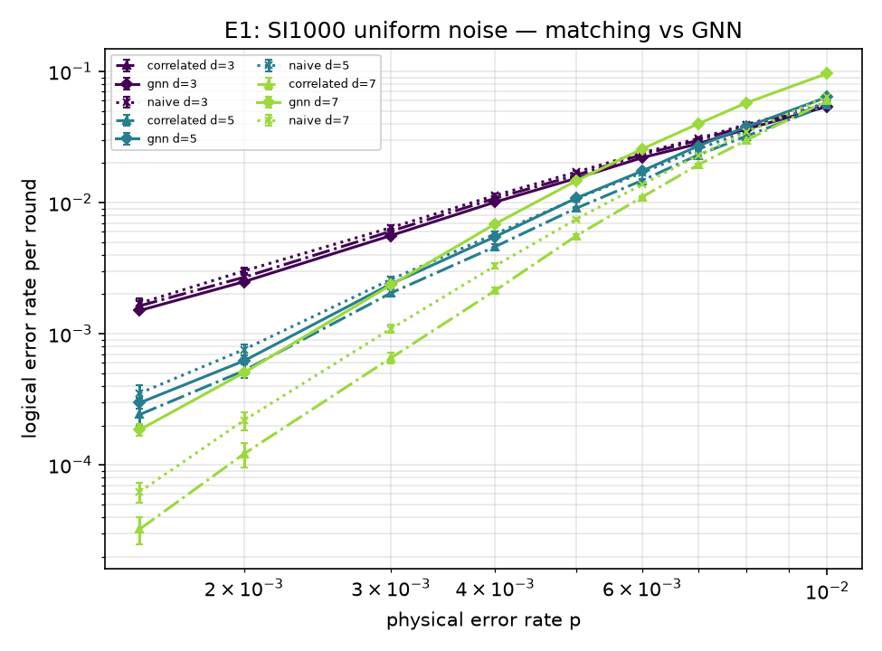
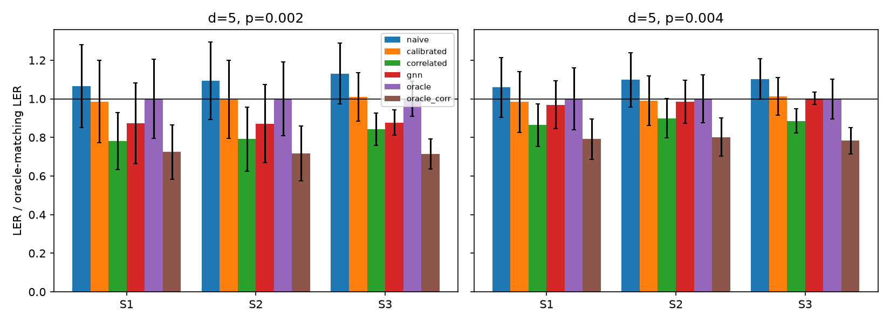
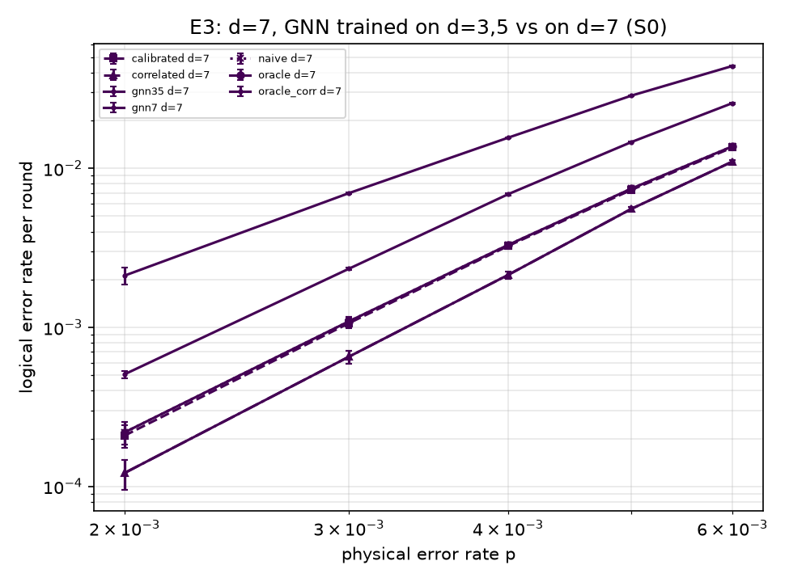
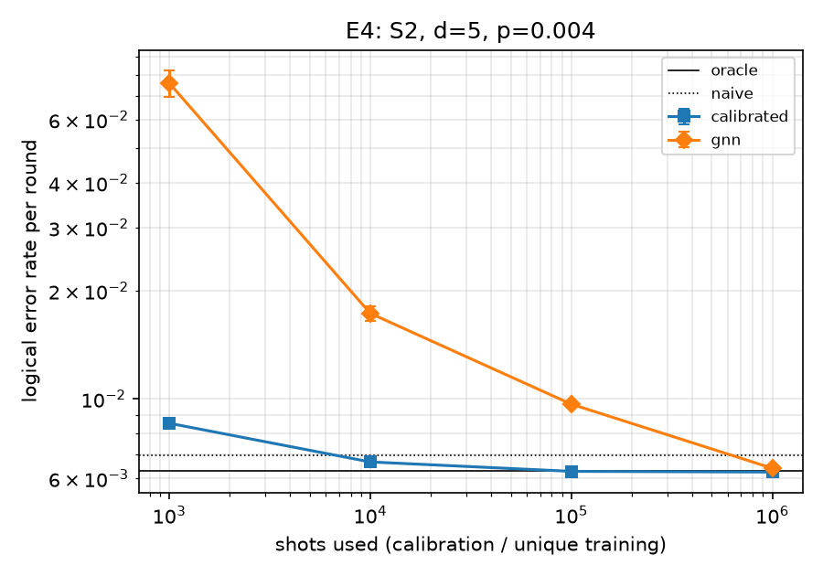
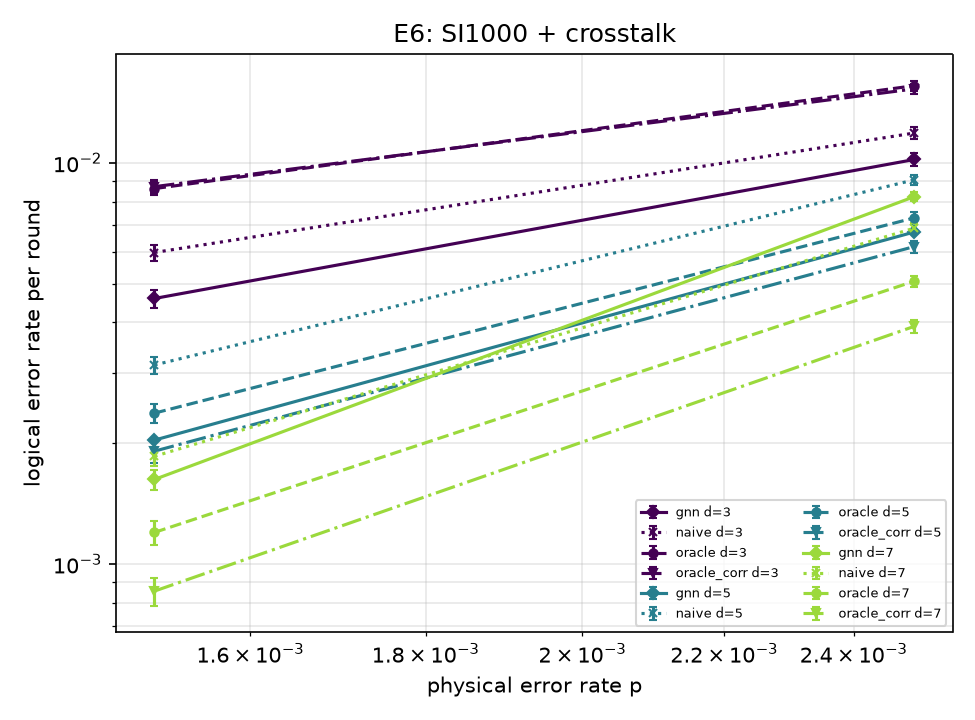
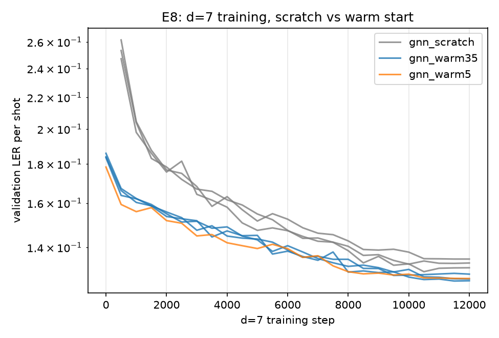
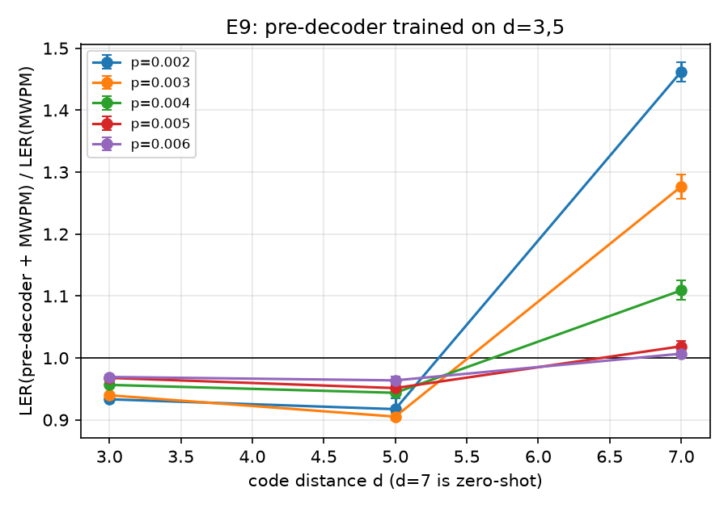
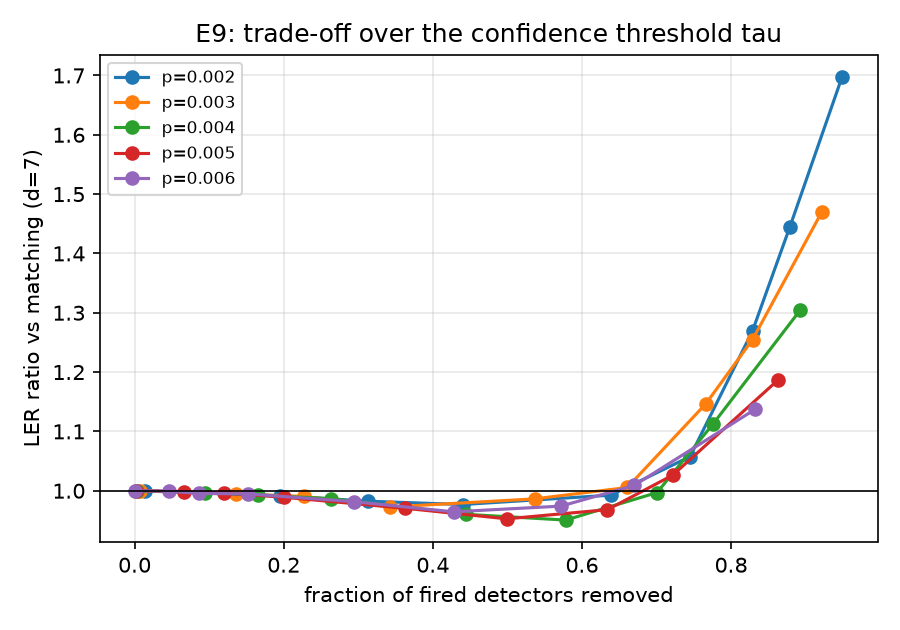

# Neural vs. matching decoders for the surface code under mismatched noise

A graph neural network (GNN) decoder, benchmarked against minimum-weight perfect matching (MWPM, via PyMatching) on rotated surface-code memory experiments at distances d = 3, 5, 7, under circuit-level noise that the decoder was **not** told about.

**Author:** Uhenraj Jarga Magar. **Status:** complete benchmark; all numbers below are generated from `results/*.jsonl` by the code in this repo.

## TL;DR

The original hypothesis was that a decoder trained only on syndromes, which learns the real noise, would beat matching when matching's noise model is wrong. **That was only weakly supported**, and the GNN did not scale.

| Finding | Evidence |
|---|---|
| At **d = 3** the GNN has the lowest error of every decoder in E1, E2 and E6. It clearly beats naive, calibrated and oracle matching. Its margin over correlated matching is small (6–8%), consistent across scenarios, but single-point intervals in E1 overlap slightly. | E1, E2, E6 |
| Under **crosstalk** the GNN beats naive, calibrated and oracle matching at d = 3 and 5. Correlated matching given the true noise (`oracle_corr`) is still better at d = 5. | E6 |
| At **d = 7** the GNN is **about 2× worse** than every matching variant, and it does not transfer from d = 3, 5. | E1, E2, E3 |
| Under per-qubit mismatch, naive matching is only about 10% worse than oracle matching, so there is little headroom. At d = 5 the GNN is statistically indistinguishable from oracle matching. | E2 |
| The GNN needs about 100× more data than calibrated matching (10⁶ vs 10⁴ shots), and a Python/PyTorch decoder is 100–1000× above the ~1 µs/round hardware budget. | E4, E5 |
| Adapting to drift with few new shots: **inconclusive**, because the drift was too weak to create a gap. | E7 |
| Warm-starting the d = 7 GNN from d = 3,5 weights lowers its test error by ~15%, but it stays ~1.8× worse than matching. | E8 |
| A local GNN pre-decoder (removes 70–90% of fired detectors, then matching) beats matching by 3–10% at d = 3, 5, but zero-shot at d = 7 it is worse at low error rates: pre-registered verdict *partial*. A stricter threshold looks sufficient post hoc (unconfirmed), and the Python implementation is 10–25× slower than matching. | E9 |

So this is mostly a **negative result with one clean positive** (small-distance crosstalk). The d = 7 failure is a statement about *this GNN under this training budget*, not about neural decoders in general (see Limitations).

## Background in linear-algebra terms

A stabiliser code is defined by a binary parity-check matrix `H`. A set of qubit errors `e ∈ F₂ⁿ` produces the syndrome `s = H e (mod 2)`. Decoding means choosing a correction `ê` with `H ê = s` that preserves the logical state.

- **Matching:** build a graph whose nodes are check outcomes ("detectors") and whose edges are single faults, weighted `log((1−p)/p)`. The most likely error is the minimum-weight set of edges pairing up the fired detectors. This is exact for independent, graph-like faults.
- **Where it breaks:** a Y error (or a correlated two-qubit fault) flips X-type *and* Z-type detectors at once. Matching must split that into independent edges, discarding the correlation (Stim's `decompose_errors`). Matching is also only as good as the edge weights it is given.
- **Neural decoder:** learn the map from syndrome to logical flip directly. It never sees a noise model, so it can in principle exploit correlations and hardware-specific rates that matching's graph cannot.

## Setup

**Code:** rotated surface code, Z-basis memory, `rounds = d`, d ∈ {3, 5, 7}, simulated with [Stim](https://github.com/quantumlib/Stim). The logical error rate (LER) is reported **per round**, `ε = ½(1 − (1 − 2P_L)^{1/r})`, so different distances are comparable.

**Noise.** Base model is **SI1000**: two-qubit gates p, single-qubit gates p/10, resets 2p, measurements 5p, idling p/10 (2p while qubits idle during measurement/reset). Noise is inserted by our own pass (`src/noise.py`) so every qubit and gate can have its own rate. With uniform rates the pass reproduces Stim's built-in generated noise exactly, which is unit-tested. The SI1000 threshold measured here, where the naive matching d = 5 and d = 7 curves cross, is **≈ 0.83%**.

| ID | Scenario | True noise |
|---|---|---|
| S0 | Uniform | SI1000 (control) |
| S1 | Heterogeneous | every qubit/gate rate × exp(0.5·z), z ~ N(0,1), channel means preserved |
| S2 | + bad couplers | S1 plus 3 random CX gates at 8× their rate |
| S3 | + drift | S2 at calibration time; at test time every rate additionally × exp(0.3·z′) |
| S4 | Crosstalk | SI1000 plus correlated XX and ZZ faults at 0.25·p between neighbouring data qubits in different CX gates of the same layer |

A **device instance** is one seeded random draw of the rates. S1–S3 results are averaged over 3 instances. (S4's strength was lowered from 1.0 to 0.25 because at 1.0 the code was above threshold: error rates grew with d.)

**Decoders.** Every decoder decodes the *same* sampled syndromes.

| Decoder | What it knows |
|---|---|
| `naive` | MWPM on the nominal SI1000 model at p, i.e. what you have if nobody recalibrates |
| `calibrated` | MWPM with edge weights re-estimated from detection-event correlations on 10⁶ shots of the (pre-drift) device. The standard p_ij estimator |
| `oracle` | MWPM on the exact true error model at test time |
| `correlated` | PyMatching's correlated matching on the naive model |
| `oracle_corr` | Correlated matching on the exact true model: the strongest classical baseline here |
| `gnn` | Syndromes and logical-flip labels only |

**GNN** (`src/gnn.py`, plain PyTorch, 133,761 parameters, no PyTorch Geometric). Nodes are the *fired detectors only*, with features that are distance-independent: stabiliser type, distances to the four lattice boundaries (raw units, clipped at 4) and first/last-round flags. Edges connect the 8 nearest neighbours in space-time. Four message-passing layers (hidden 64, residual + LayerNorm), mean ⊕ max pooling, MLP head. The same weights run at any distance. Training: shots sampled on the fly from Stim across a band of error rates, Adam with cosine decay, 12 000 steps × 1 024 shots (≈ 12M shots), early stopping on a fixed validation set that is disjoint from the test set. Seed ranges for training, validation and test never overlap (unit-tested).

**Statistics.** Test shots are sampled until the oracle decoder has seen ≥ 100 logical errors (in practice 10⁵ or more shots per point). Wilson 95% intervals are stored per point in `results/*.jsonl`. ± in the tables is a standard deviation over GNN training seeds (E1, E6) or device instances (E2), as labelled.

## Results

### E1: uniform noise (control)



Per-round LER at p = 0.002 (GNN: mean ± std over 3 training seeds):

| decoder | d = 3 | d = 5 | d = 7 |
|---|---|---|---|
| naive | 3.01e-03 | 7.58e-04 | 2.19e-04 |
| calibrated | 2.95e-03 | 7.40e-04 | 2.10e-04 |
| correlated (= oracle_corr) | 2.70e-03 | 5.23e-04 | 1.22e-04 |
| **gnn** | **2.49e-03** ± 7e-06 | 6.22e-04 ± 5e-06 | 5.05e-04 ± 2e-05 |

Under uniform noise naive, calibrated and oracle matching coincide, as they should, so the only differences are structural. The GNN is lowest at d = 3. Against correlated matching the single-point margin is small: per-shot LER 0.0075 vs 0.0080 at p = 0.002 (95% intervals [0.0070, 0.0080] and [0.0075, 0.0086], overlapping) and 0.0297 vs 0.0316 at p = 0.004 (intervals [0.0287, 0.0308] and [0.0306, 0.0328], overlapping slightly). All decoders see the same shots, so the paired difference is tighter than these intervals suggest, but I did not store per-shot results to test it. Against naive and calibrated matching the gap is clear. It sits between naive and correlated matching at d = 5 and is far behind at d = 7. Error suppression per distance step at p = 0.002 is **Λ ≈ 3.7 for naive matching, 4.7 for correlated matching and 2.2 for the GNN**.

### E2: mismatched noise (S1–S3)



Per-round LER at p = 0.004, mean over 3 device instances, scenario S2 (S1 and S3 look the same; see `results/e2.jsonl`):

| decoder | d = 3 | d = 5 | d = 7 |
|---|---|---|---|
| naive | 1.20e-02 | 6.08e-03 | 3.16e-03 |
| calibrated | 1.15e-02 | 5.48e-03 | 2.79e-03 |
| oracle | 1.20e-02 | 5.54e-03 | 2.86e-03 |
| correlated | 1.12e-02 | 4.98e-03 | 2.17e-03 |
| oracle_corr | 1.11e-02 | 4.44e-03 | 1.89e-03 |
| gnn | 1.02e-02 | 5.46e-03 | 6.35e-03 |

- **Mismatch is a small effect for matching.** Naive is only ~10% worse than oracle at d = 5, and calibrated matching recovers essentially all of it from syndrome data alone. That leaves a learned decoder little to win.
- At d = 5 the GNN matches oracle matching, but in the bar chart the differences between naive, calibrated, oracle and GNN are **within the error bars** (which are standard deviations over only 3 device instances). Only the correlated variants are clearly better.
- At d = 7 the GNN is about 2× worse than everything.

### E3: transfer from d = 3, 5 to d = 7



At d = 7, p = 0.004, S0, per-round LER: GNN trained on d = 3, 5: **1.56e-02**; GNN trained at d = 7: 6.87e-03; naive matching: 3.30e-03. In S1, trained across 20 random devices and tested on 3 unseen d = 7 devices: 1.66e-02 (trained on d = 3, 5), 7.44e-03 (trained at d = 7), 3.31e-03 (naive), 3.05e-03 (oracle). **Zero-shot transfer fails** (2.3× worse than in-distribution), and even the in-distribution d = 7 GNN is about 2× worse than matching. A depth/width ablation (8 layers, hidden 96) at d = 7 did **worse** (validation LER 0.159 vs 0.132–0.135): the larger model trained more slowly and had not caught up after 12 000 steps. Whether a longer-range architecture would fix d = 7 is untested.

### E4: data efficiency (S2, d = 5, p = 0.004)



| shots | calibrated MWPM | GNN |
|---|---|---|
| 10³ | 8.55e-03 | 7.59e-02 |
| 10⁴ | 6.67e-03 | 1.73e-02 |
| 10⁵ | 6.28e-03 | 9.67e-03 |
| 10⁶ | 6.25e-03 | 6.41e-03 |

Oracle matching: 6.29e-03; naive: 6.95e-03. Calibrated matching reaches the oracle with about 10⁴ shots. The GNN needs about 10⁶ and only then catches up (mean of 3 seeds).

### E6: crosstalk (S4)



Per-round LER at p = 0.0025 (GNN: mean ± std over 3 seeds at d = 5, single seed otherwise). `oracle_corr` is not available at d = 3 (see the note below):

| decoder | d = 3 | d = 5 | d = 7 |
|---|---|---|---|
| naive | 1.16e-02 | 9.09e-03 | 7.24e-03 |
| calibrated | 1.13e-02 | 8.32e-03 | 6.82e-03 |
| oracle | 1.13e-02 | 7.43e-03 | 5.21e-03 |
| correlated | 1.15e-02 | 8.60e-03 | 6.46e-03 |
| oracle_corr | n/a | 6.26e-03 | 4.02e-03 |
| **gnn** | **9.73e-03** | **6.91e-03** ± 5e-05 | 8.40e-03 |

This is the GNN's best result. At d = 3 it is below every matching variant (per-shot 0.0286 [0.0276, 0.0297] vs 0.0330 [0.0319, 0.0341] for oracle matching). At d = 5 it beats naive, calibrated, correlated **and oracle** matching, which cannot represent the crosstalk correlations exactly even with the true error model (per-shot 0.0338 [0.0327, 0.0349] for the GNN vs 0.0360 [0.0349, 0.0372] for oracle). `oracle_corr`, correlated matching on the true model, remains better (0.0305). At d = 7 the GNN is again behind.

**A matching-graph pitfall found along the way.** In a first run the d = 3 oracle was *worse* than naive matching. The cause: under crosstalk two different faults flip the same detector, one with a logical flip (probability 0.0125) and one without (0.000625). A matching graph holds one logical-flip label per edge, and PyMatching's merge kept the wrong one. Restoring the correct label cut that decoder's error from 4.44% to 3.29% per shot. `src/dem_tools.py` now builds matching graphs that keep the label of the most probable mechanism; it is identical to PyMatching's default wherever there are no such conflicts (checked: zero differing predictions on 100 000 shots in S0, S2 and S4), and only S4 at d = 3 has any (14 edges). PyMatching's correlated mode cannot be rebuilt this way, so `oracle_corr` is omitted at d = 3. The first run is preserved in `runs/2026-11-20_baseline_v1`, the corrected one in `runs/2026-11-24_v2_e6_robust_matching`.

### E7: adapting to drift (S3, d = 5, p = 0.004): inconclusive

| new shots | stale calibrated | recalibrated | stale GNN | fine-tuned GNN | oracle |
|---|---|---|---|---|---|
| 10³ | 5.58e-03 | 7.85e-03 | 5.50e-03 | 7.21e-03 | 5.49e-03 |
| 10⁴ | 5.58e-03 | 5.69e-03 | 5.50e-03 | 5.88e-03 | 5.49e-03 |
| 10⁵ | 5.58e-03 | 5.45e-03 | 5.50e-03 | 5.62e-03 | 5.49e-03 |

The drift (δ = 0.3) was too weak to matter: the stale decoders are already within 2% of oracle matching, so there was nothing for adaptation to recover. With 10³ new shots both methods get *worse* because they overfit. A stronger drift would be needed for a meaningful test.

### E8: warm-starting the d = 7 GNN



Because the GNN's weights do not depend on the code distance, a d = 7 model can start from one already trained on smaller codes. Four d = 7 runs, identical to the from-scratch runs (same grid, steps, learning rate and seeds) except for their initial weights: three start from models trained jointly on d = 3 and 5, one from d = 5 alone (12 000 steps each, about 16 minutes on one RTX 4090).

Test-set per-round LER at d = 7 (S0; GNNs: mean ± std over 3 seeds, the d = 5 start is one seed):

| p | naive MWPM | correlated MWPM | GNN from scratch | GNN warm (d = 3,5) | GNN warm (d = 5) |
|---|---|---|---|---|---|
| 0.002 | 2.33e-04 | 1.46e-04 | 5.49e-04 ± 3e-05 | 4.18e-04 ± 9e-06 | 4.35e-04 |
| 0.003 | 1.08e-03 | 6.45e-04 | 2.50e-03 ± 4e-05 | 2.03e-03 ± 4e-05 | 1.94e-03 |
| 0.004 | 3.28e-03 | 2.16e-03 | 6.70e-03 ± 1e-04 | 5.78e-03 ± 1e-04 | 5.57e-03 |
| 0.005 | 7.35e-03 | 5.53e-03 | 1.46e-02 ± 2e-04 | 1.32e-02 ± 1e-04 | 1.29e-02 |
| 0.006 | 1.38e-02 | 1.09e-02 | 2.56e-02 ± 1e-04 | 2.36e-02 ± 6e-05 | 2.33e-02 |

Warm starting **helps consistently but not enough**: on average the test error is 15% lower than from scratch (24% at p = 0.002, 8% at p = 0.006), all three warm seeds beat all three scratch seeds, and the warm runs need 7 500–9 500 steps to reach the scratch runs' best validation score (about a quarter fewer). The warm-started GNN is still 1.8× worse than naive matching and 2.9× worse than correlated matching, so initialisation is not the main obstacle at d = 7. Together with the failed 8-layer ablation, this points at the model's limited view of a d = 7 code (four message-passing rounds over eight neighbours per detector), which is untested.

### E9: neural pre-decoder + matching



A different way to combine the two: a *local* GNN removes the easy faults and matching decodes what is left. Stim's fault sampler says exactly which faults fired in each shot. A fault is **isolated** if no other fired fault touches either of its detectors, which makes it the unambiguous explanation of those detectors. The pre-decoder scores every candidate (a pair of fired detectors that is a matching edge, or a fired detector with a boundary edge) as isolated or not, removes those scored at least τ (no detector used twice), applies the removed faults' logical labels, and hands the residual syndrome to the **same matching graph and weights as the baseline**. Same 134k-parameter architecture and training recipe as the GNN; three seeds trained on d = 3 and 5, one reference trained at d = 7 (design: `docs/design/2026-11-24-neural-predecoder-design.md`).

The test protocol was fixed before any test shot: τ chosen on **d = 5 validation shots only** (τ = 0.7, committed before the test run, in the commit titled "exp: E9 threshold tau=0.7 chosen on d=5 validation shots only") and applied unchanged at every distance, and a decision rule stated in advance: *positive* if at d = 7 zero-shot the error ratio is ≤ 1.05 **and** ≥ 30% of fired detectors are removed at p = 0.002.

Ratio of logical error rate, pre-decoder + matching over matching alone, on identical shots (mean ± std over 3 seeds; below 1 is better) and the fraction of fired detectors removed:

| p | d = 3 | d = 5 | d = 7 (zero-shot) | removed (d = 3 / 5 / 7) |
|---|---|---|---|---|
| 0.002 | 0.933 ± 0.002 | 0.917 ± 0.017 | **1.462 ± 0.016** | 88% / 90% / 88% |
| 0.003 | 0.940 ± 0.003 | 0.905 ± 0.006 | 1.277 ± 0.019 | 85% / 86% / 83% |
| 0.004 | 0.956 ± 0.002 | 0.944 ± 0.003 | 1.109 ± 0.016 | 82% / 81% / 78% |
| 0.005 | 0.968 ± 0.001 | 0.951 ± 0.004 | 1.019 ± 0.008 | 79% / 76% / 72% |
| 0.006 | 0.969 ± 0.003 | 0.964 ± 0.006 | 1.007 ± 0.003 | 76% / 71% / 67% |

**Verdict under the pre-registered rule: partial.** At d = 7, p = 0.002 (700 000 shots, 1 076 matching errors) 88% of fired detectors are removed (bar: 30%, met) but the error ratio is 1.46 (bar: 1.05, not met; paired test p ≈ 1e-40).

- **Where it was trained it beats matching** while removing 71–90% of the detectors. At d = 3 every paired comparison has p < 1e-11; at d = 5 the gain is significant from p = 0.004 upward and marginal at p = 0.002 (p between 0.005 and 0.06 across seeds).
- **At d = 7 it gets worse as the error rate falls**, and the d = 7-trained reference does too (ratio 1.30 at p = 0.002, 1.02 at p = 0.004, 0.96 at p = 0.006), so this is not only a transfer failure.
- **Removal precision is not the problem:** at τ = 0.7 the fraction of removed faults that were truly isolated is 0.925–0.967 and no lower at d = 7 than at d = 3 (recall of isolated faults 0.77–0.88). My working explanation, which I have **not tested**, is that matching's own logical failures become extremely rare at d = 7 and low p, so a few percent of wrong removals dominate.
- **The threshold was probably too aggressive.** *Exploratory, on test shots already seen, so it does not change the verdict:* at d = 7, p = 0.002 a threshold of 0.95 gives ratio 0.993 while removing 64% of fired detectors, and 0.98 gives 0.977 at 44%; the ratio only rises above 1 beyond roughly 70% removal (`figures/e9_tradeoff_d7.png`). The validation set that chose τ = 0.7 pooled errors across error rates, so p = 0.006 carried about 70% of the weight. Whether a stricter rule passes on fresh shots is **not yet confirmed**.
- **Speed is a net loss as implemented.** Matching on the residual is 3–5× faster than on the full syndrome (e.g. 1.7 vs 6.2 µs per shot at d = 7, p = 0.002), but the Python pre-decoder costs 45–402 µs per shot (inference plus the removal step) against 2–19 µs for matching alone, so the combination is **10–25× slower than matching on a CPU** (`results/e9_diag.json`). This says nothing about a hardware implementation.



### E5: latency

Median microseconds per round (graph build + forward for the GNN), p = 0.004, S0:

| d | MWPM, one shot | MWPM, batch 4096 | GNN B = 1 (CPU) | GNN B = 64 (CPU) | GNN B = 4096 (CPU) | GNN B = 4096 (GPU) |
|---|---|---|---|---|---|---|
| 3 | 1.36 | 0.13 | 367 | 14.8 | 4.2 | 6.3 |
| 5 | 1.33 | 0.65 | 355 | 32.1 | 43.1 | 9.2 |
| 7 | 2.03 | 1.51 | 271 | 38.2 | 84.5 | 7.0 |

Superconducting hardware needs roughly **1 µs per round**. Matching in C++ (PyMatching) is close; this Python/PyTorch GNN is 100–1000× too slow for online decoding. The GPU figures include the host-to-device transfer inside the "graph" step. Measured on a shared cloud VM (a ~13-CPU slice) rather than a quiet workstation, so treat absolute values as indicative. p99 values are in `results/e5_*.json`.

## Limitations

- **The d = 7 failure is not a general verdict on neural decoders.** The GNN had four message-passing layers, 12M training shots and one hyper-parameter setting, and its validation error was still falling slowly at the end. One capacity ablation made it worse. Whether a larger receptive field, longer training or a pre-decoder design would fix d = 7 is untested.
- **The mismatch hypothesis had little headroom**: with these noise strengths (σ = 0.5, 3 bad couplers at 8×, drift δ = 0.3), calibrated matching nearly closes the gap by itself. Stronger or differently structured mismatch might show more.
- Error bars in E2 are standard deviations over only 3 device instances; many differences there are within them.
- Simulated Pauli noise only: **no leakage, erasure or real hardware data**. One code family and one memory basis (Z).
- The E9 threshold-sweep result (a stricter τ would pass at d = 7) comes from shots that had already been seen, so it is a hypothesis, not a confirmed result.
- Test shots are not bit-identical across machines, so re-running an experiment elsewhere can move individual points by a few percent (sampling noise); compare runs with `scripts/compare_runs.py` and judge changes against the stated intervals.
- Latency is measured in Python on CPU and a single GPU; it says nothing about FPGA/ASIC feasibility.

## Reproduce

```bash
uv venv --python 3.12 && .venv/Scripts/activate           # Windows; use bin/activate elsewhere
uv pip install stim pymatching sinter torch numpy matplotlib pytest
python -m pytest                                           # 76 tests, ~25 s

python -m experiments.train_jobs --device cuda             # all 59 GNN training jobs, resumable
# evaluation: each script takes --shard i/n to split points across processes
python -m experiments.e1_control --shard 0/27              # ...and likewise e2_mismatch, e3_generalise,
python -m experiments.e4_budget --shard 0/12               #    e4_budget, e6_crosstalk, e7_drift_adapt
python -m experiments.e1_control --plot                    # merge shards -> results/*.jsonl and figures
python -m experiments.e5_latency --device cuda             # and --device cpu
python -m scripts.make_readme_assets                       # clean figures and the tables above
```

All 59 training jobs plus the ablation took about 4 hours of pod time on one RTX 4090 (≈ US$3 on RunPod Secure Cloud); evaluation ran on the same machine's CPUs. `scripts/pod_run.sh` and `scripts/pod_pipeline.sh` are the unattended cloud drivers. `checkpoints/` (43 MB) is git-ignored. `results/raw/` holds per-shard outputs.

## Layout

```
src/noise.py        per-qubit/gate noise insertion, SI1000, crosstalk
src/scenarios.py    S0-S4 and seeded device instances
src/calibrate.py    p_ij estimator -> re-weighted matching
src/graph.py        syndrome -> k-nearest-neighbour graph batches
src/gnn.py          plain-torch message-passing decoder
src/train.py        on-the-fly training, early stopping, fine-tuning
src/evaluate.py     shared-shot evaluation, Wilson intervals, Λ fit
experiments/        jobs.py (all training jobs), e1 ... e7 scripts
docs/design/        design documents
```

## License

MIT, see `LICENSE`.
